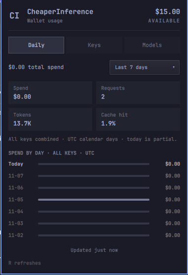

# CheaperInference Usage for Omarchy

CheaperInference wallet balance and daily usage across all API keys, including usage from other machines and apps. Requires one [API key](https://www.cheaperinference.com/docs) with **Usage reporting** (usage:read) access. Inference keys work too, but a reporting-only key cannot spend wallet funds or submit inference requests — use one for this widget.

The taskbar and panel header show the live **available** balance (`available_usd`, i.e. what can still be spent after reservations) without crowding the bar. Balances below `$1,000` keep their cents, larger balances use `k` notation such as `$12.3k`. Hover over the taskbar widget for the exact amount.



## Install

Requires Omarchy 4.x and Python 3.

```bash
omarchy plugin add https://github.com/thouet/omarchy-cheaperinference-usage.git --enable
```

Edit `~/.config/omarchy/agents/cheaperinference.json` to contain your API key:

```json
{
  "apiKey": "ci_live_…"
}
```

Protect the config file:

```bash
chmod 600 ~/.config/omarchy/agents/cheaperinference.json
```

Alternatively, set `CHEAPERINFERENCE_API_KEY` in the shell's environment. This takes precedence over the file. Keep live keys out of Git.

## Daily usage

The panel lists spend per UTC calendar day with all keys combined. Hover over a day for token and request counts. Today is partial and reflects the data currently available from CheaperInference.

The panel has three tabs: Daily, Keys, and Models. Daily shows the spend-by-day chart. Every tab shows spend, requests, tokens, and cache hit rate directly below the period filter. The other tabs list spend per API key or model, highest spend first. Hover over an entry for its full name and token count. Only entries with recorded activity appear.

All tabs share one dropdown for the last 3, 7, 30, or 90 UTC calendar days, including today. The default is seven days. Changing the period updates every tab. Missing days in a successful query show zero.

The CheaperInference usage API reports at **day grain only** (see the [Usage and billing docs](https://www.cheaperinference.com/docs#usage-and-billing)), so there are no hourly windows: this widget intentionally drops the 4h/8h/24h periods its OpenRouter cousins have.

Daily totals come from `/v1/usage/daily`, which returns every calendar date in the range including zero-request days. Per-key and per-model breakdowns come from `/v1/usage/requests`, walked through all pages (100 records per page). If a breakdown query fails, the affected tab shows an error instead of an incomplete list; daily usage stays visible. Unattributed usage appears as Unknown.

The wallet balance comes from `/v1/account/balance`, which needs the **account:read** scope. A usage-only key receives 403 on that endpoint; the widget then shows usage without a balance instead of failing. Balance errors never hide daily usage. Cache files are private and separated by credential and selected period.

## Settings

Right-click the bar icon or press `R` in the panel to force a refresh.

| Setting | Default | Meaning |
|---|---|---|
| `refreshIntervalSec` | 300 | Automatic refresh interval |

Successful usage is cached for five minutes. Forced refresh bypasses the cache.

For the optional budget gauge, add `"fundedAmount": 100` beside `apiKey`. This expresses your chosen funded amount in USD; it is not a spending limit. With it set, the bar icon turns urgent when the available balance drops to 10% of that amount.

## Remove

```bash
omarchy plugin remove thouet.cheaperinference-usage
```

Optionally remove `~/.config/omarchy/agents/cheaperinference.json` and the plugin's files under `~/.cache/omarchy/agent-usage/`. The plugin does not edit other user configuration.

## Verification

```bash
python -m unittest discover -s tests -v
./bin/collect --force --period 7d
omarchy plugin validate ~/.config/omarchy/plugins/thouet.cheaperinference-usage
```

The tests use mocked API responses and do not need credentials. The collector command uses your configured API key.

## Credits and license

MIT license. Widget structure follows Omarchy's [plugin development guide](https://plugins.omarchy.org/develop.html) and is adapted from [digitalbase/omarchy-openrouter-plus-improved](https://github.com/digitalbase/omarchy-openrouter-plus-improved). This project is not affiliated with Cheaper Inference or Omarchy.
